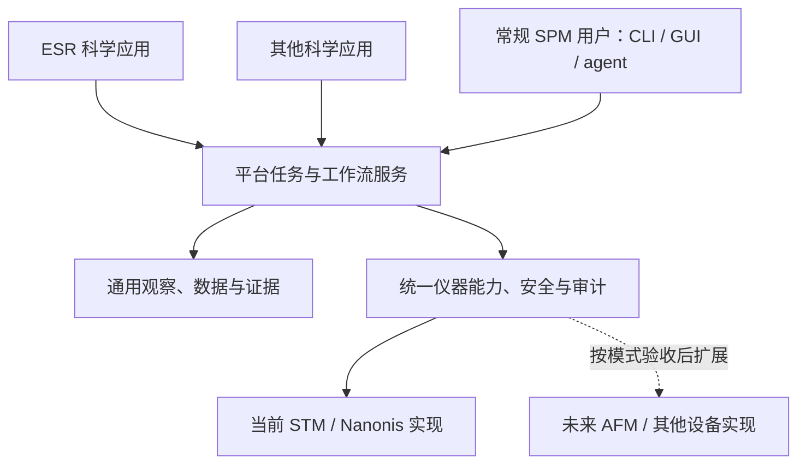

# 通用 SPM 平台与科学实验模块

## 两部分与依赖方向

**基础平台**面向大部分 SPM 使用者，当前首先服务 STM/Nanonis。
普通用户应能使用记录、读图、设备状态和已验收的通用操作，
无需理解 ESR、安装专用物理计算环境或配置某个 LLM 账号。
不同设备暴露不同能力，“通用”要求接口诚实、组合容易，不要求假装每台设备功能相同。

**科学实验模块**解决具体研究问题，例如 ESR 或其他以后加入的实验。
它们调用平台，提供自身目标、策略、领域知识与结果解释，可独立启用。

平台不能反向依赖 ESR 或某种样品的物理模型。科学应用也不能绕开平台直接连 Nanonis。
产品分离不意味着再做一套 MCP server、记录器、安全门或底层命令封装。
“独立”目前指职责与依赖隔离；仓库数量、发布包边界和部署进程数量尚未由这个定位决定。

## 与既有约束的一致性审查

| 既有约束 | 新定位的关系 | 决定 |
|---|---|---|
| 七层直接位于 `src/`，禁止 shim 和旧入口 | 产品边界是另一个分类维度，不能替换层次规则 | 保留七层；本批不迁移包路径 |
| NanonisDevice、SafetyGate、RunStore 和工具登记唯一实现 | 如果给 ESR 复制一套控制栈就直接冲突 | 应用只消费共用实现 |
| workflow 负责修针、找原子和 ESR campaign | 与应用分离并不矛盾：归属不同，职责仍是编排 | 通用采集/维护可在平台，专用研究策略归应用；不能把所有 workflow 移出平台 |
| analysis 负责候选点、谱拟合和 ESR 特征 | 专用分析可以使用通用数值组件，但不能成为核心隐式依赖 | 按依赖和科学语义划分，不按是否“分析数据”一刀切 |
| fake-first、live-disabled、单独站点验收 | 与“面向大部分 SPM”相容，但不能被推广目标覆盖 | 保留所有执行边界；不承诺现有 STM 判据适用于 AFM |
| memory 不能自行提升为知识 | 科学 agent 可产生新假设，不能因此改写权威规则 | 保留评审晋升边界 |

实际代码存在待梳理的耦合，例如 `analysis_layer/__init__.py` 直接导出 Ag(111) 专用分析，
`workflow_layer/__init__.py` 直接导出参考样品复核流程，`SPMTools` 直接装配原子 campaign。
前两项需要审查是否让专用知识成为通用入口依赖；后一项还要区分通用点位采集与身份解释，
不能仅根据模块名包含 atom 就整体移走。这些事实说明新定位需要有计划的迁移，
并非改 README 后已经实现了独立安装。

本次选择：先固定职责和单向依赖目标，保留当前运行路径。以后按可独立验收的批次迁移，
用“移除专用应用后基础功能仍可运行”验证结果，再决定是否有必要拆分发布包。
立刻复制七层、建立两个仓库或造一个万能 SPM 接口，都会增加维护成本而没有当前验证依据。

## 功能归属

| 内容 | 归属 | 边界 |
|---|---|---|
| 连接、设备身份、版本兼容、能力与站点验收 | 平台 | 配置按设备/站点隔离，未知支持情况不能默认可用 |
| 信号记录、扫描/谱文件读取、坐标和来源校验 | 平台 | 不依赖 ESR 或指定样品名 |
| 图像去背景、显示、裁剪、有效区域与数据质量检查 | 平台 | 保留原始数据，处理可追溯 |
| 扫描、定位、测谱、进退针等设备操作 | 平台能力 | 按 STM/AFM 模式和实际接口选择，遵守已验收的安全边界 |
| 通用点位采集、预算、任务状态、暂停/取消和后验检查机制 | 平台 | 应用提供科学目标；平台保证执行与证据一致 |
| 探针健康检查与维护流程 | 平台的可选模式能力 | 不是所有 SPM 都采用电流判据、pulse 或 Tip Shaper；本站 recipe 不是通用默认 |
| 某种原子的身份及参考谱解释 | 科学模块或专用领域知识 | 通用检测器可以提供候选点，不能因此宣称识别了 Fe/Ti 等身份 |
| ESR 实验设计、扫频/功率策略、目标选择和物理模型 | ESR 科学模块 | 复用平台服务，领域验收与仪器执行结果分开 |
| RF 等附加设备的通用驱动与 fake backend | 平台可选设备能力 | 驱动可被多个实验复用；ESR 应用只编排，不自己建通信旁路 |
| 科学假设、模型比较、研究结论和专用补测策略 | 对应科学模块 | 科学推断不能扩大硬件权限 |
| 本站路径、轴向、校准、经验参数与参考样品 | 站点配置/知识 | 明确适用性，不强迫其他用户继承 |

例如“在已批准的点位采集一条谱并保存来源”是平台能力；
“为某个自旋体系选择什么测量并如何解释谱峰”属于科学模块。
图像质量检查可以共用，“满足某项 ESR 科学目标”必须由该应用定义和验证。

## 保留七层，明确两种归属

现有 `src/` 七层继续有效，表示职责和依赖规则；平台/科学应用表示产品归属。
两者不是互相替代的目录方案。

| 技术层 | 平台职责 | 科学应用可提供的内容 |
|---|---|---|
| instrument | 唯一设备驱动、typed API、fake、安全与能力 | 提交所需能力，不能在应用内另写控制后门 |
| data | 原始文件、记录、坐标、来源与通用 artifact | 通过公共机制保存专用结果和领域元数据 |
| analysis | 通用图像/谱质量、配准、数值工具 | 专用特征、物理拟合、模型比较 |
| knowledge | 设备/模式知识、公共服务描述和登记机制 | 专用实验协议、领域文献、先验与适用范围 |
| memory | 历史记录和检索机制 | 带应用身份、版本和适用条件的经验 |
| workflow | 通用执行、预算、状态和可组合维护/采集流程 | ESR campaign 或其他研究策略的编排 |
| runtime | CLI / MCP 等入口、公共分发和服务装配 | 声明所需服务、选择应用工作流及报告 |

当前并非上述每项能力都已完成。例如 memory 仍为占位，MCP 主要提供离线观察与 fake 演练。
现有包内也还混合了若干领域功能；本文确立拆分依据，不声称独立安装边界已经实现。
不为了展示分层创建空包、兼容 shim 或第二套基础设施。

## 应用接入契约与依赖约束

后续应用应声明自身身份/版本、支持的模式、所需 capabilities、输入输出、知识来源、
科学验收与可选依赖；依照现有唯一登记机制装配工具，不复制公共工具条目。
科学应用的选择或安装不能开启 `live_enabled`；设备许可仍由平台和站点验收管理。

应用声明的参数需求必须交给平台验证。如果新设备动作尚不存在，应按 AGENTS 的流程
扩展 instrument layer / SafetyGate / fake，再供应用调用。
应用预算可以进一步限制执行次数和时间，但不能放宽平台硬边界。

对 STM，持续电流和 Z 余量可以参与就绪判定；对 AFM，必须定义对应反馈信号、单位和验证。
不能只把 `current_a` 改名为通用数值就宣布支持另一种模式。
尚未出现第二种已验证实现时，先保持具体 typed API，避免建立缺少真实契约的万能驱动。

## 多设备接口验收

已在一台仪器完成实验流程，是该设备、软件版本与配置下的证据；读接口解析通过、
动作与回读通过、科学验收通过是不同结论。1 号机已有修针与扫描现场记录，以及人工认可的
Au111 基本合格、非最佳图谱参照；这不等于自动谱学验收已完成，不能将它或另一台设备的整个 capability 标为已验收。

遇到真实接口差异时，回归应覆盖“原始响应 → 官方解析器 → 唯一 backend → typed 接口”，
同时保留 fake 测试。只模拟最终 Python 返回值会漏掉驱动实际返回的数组结构。
0.0.44 的 ChsGet 修复即由此发现：官方驱动将整数数组解析成单元素元组列表，
现已复用已有转换函数；测试同时覆盖本站缺名称数量的响应和带名称数量的格式。
测试通过不等于已经在所有软件版本或硬件上验收。

协议格式适配留在 OfficialNanonisBackend，返回值规范化与校验留在 NanonisDevice；
workflow 只使用 typed 结果。未知格式、枚举或数量矛盾必须明确拒绝，不能靠猜值、
重发动作或扩大容差消除错误。站点的连接、信号映射、标定、授权和科学判据分别保留
适用范围；同步代码不继承另一台机器的控制授权。新设备按已有接口和 capability 扩展，
不为每台机器复制一套 workflow，也不预先建立没有第二种实现验证的通用驱动。

## 后续迁移及验收

1. 按上表标注现有模块归属，将原子身份/参考谱匹配等专用解释与通用采集/观察隔离。
2. 在现有 registry 和 runtime 的装配处引入明确应用选择；核心不 import 可选应用。
   具体拆包只在迁移实现中完成，不复制已有层或保留旧入口别名。
3. 基础安装在没有 ESR 模块、RF 设备、领域参考谱和 LLM 凭据时，仍能运行核心 fake 测试、
   记录/读图与状态服务；应用缺失不能导致基础入口加载失败。
4. ESR 模块依赖平台稳定接口；移除 ESR 后核心测试仍通过，安装 ESR 后不改变核心动作边界。
5. 更换站点配置不要求改代码或使用本站绝对路径；缺能力、错单位和模式不兼容必须明确拒绝。
6. 科学结果保存应用版本、平台版本、设备模式、参数和原始数据引用，可回查到同一审计记录。

这是后续代码分离的验收条件，本批没有宣称这些验收已全部通过。

## AIMS 阅读在两部分中的位置

对基础平台，本次阅读帮助明确观察可靠性、任务状态、故障处理和下一步服务的组合接口。
对科学模块，它启发如何维护候选解释、寻找能区分解释的证据、更新结论。
通用平台负责使后者可执行且可追溯，不内置某篇论文的物理问题、材料假设或评分函数。

进一步对照和实现优先级见
[AIMS 对 SPiRE 的设计分析](../research/agentic-spm-design.md)。
