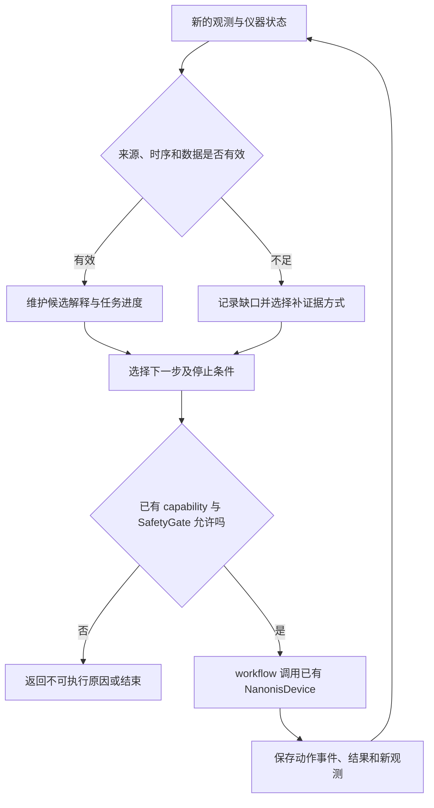

# 扫描探针 agent：历史设计与研究建议

本文保留各节注明基线时的开发分析；实验当前策略从专家知识库读取。

## 当前选择：先把 Codex 中的实验协作做实用

2026-09-26，代码对照基线为 `c0b14e6` / 0.0.60（控制实现同 0.0.59）；
云端 API 草稿尚未合入。quailbot 事实、固定源码及材料缺口见[阅读记录](../../src/knowledge_base/literature/agentic_scanning_probe_microscopy/synthesis.md)。
以下工程优先级依据操作员当前使用方式；研究假设尚未成为实验结论。

**agent 的职责是在开放的操作空间里推进任务，并能向人工求助。**
需要人工物理处理、能力或授权不足时，带证据上报并停止依赖该处理的后续动作，
不要求其死磕机械维修或穷尽故障机理。具体规则由[控制说明](../operations/authorized-control.md#人工上报与交接)统一维护。
这些范围外问题不作为当前研究突破口；及时、明确的人工交接是有效结果，不能一律算失败。

### 对方做得更好的具体部分

quailbot 在 Pi coding agent 上做仪器扩展，我们当前在 Codex 中使用 SPiRE。
因此比较对象是两套“宿主 + 仪器工具 + 实验知识”的组合，不是孤立的 SPiRE Python runtime
对比对方整套环境。源码显示其知识装配、动作后回读和历史结果投影已接入 Pi 生命周期，
这部分比 SPiRE 自己的装配完整；没有同任务实测，不能推出整体更可靠或代码质量全面更好。
开发方式、测试数量、作者履历都不能替代行为验证。

| 值得学习的做法 | SPiRE 当前事实 | 适合 Codex 的最小路径 |
| --- | --- | --- |
| 按任务装入知识 | AGENTS/知识索引已经存在，修针 loader 已用于测试及离线评审卡；无 SPiRE 自动 prompt 装配 | 先用现有入口按需读取；可将稳定重复流程接为精简技能入口，链接唯一知识正文，不复制两套策略 |
| 新结果与相关读数一起返回 | control step 已有 before/result/after，pulse 有独立观察；不同工具的语义仍有差异 | 在既有工具结果上统一“做了什么、观察到什么、未知什么、下一步是否需人工”及原图/原始数据引用 |
| 近期完整、历史紧凑 | Codex 承担当前会话；RunStore 保存原始证据，SPiRE 尚无统一实验上下文摘要 | 优先给紧凑结果和必要原图；用原有归档保存目标、样品、控制权、候选、动作和待办，恢复时重新回读实时状态 |
| 明确记忆与当前知识 | 专家知识、复盘和 memory 有职责区分，memory 实现仍占位 | 保留来源与适用条件；经验先存复盘，审核后更新唯一知识，不直接照搬自更新为权威规则 |

Codex 已提供技能名称/描述发现、按需加载全文的机制，见
[官方技能文档](https://learn.chatgpt.com/docs/build-skills)。不为复制对方内部 hook
而先写另一套 agent 宿主；对方的 CLI/技能/图像窗口也不代表 Codex 插件可直接控制相同内部窗口。
能直接改进的是进入模型的内容与持久证据的组织。云端 API 分支可以作为未来独立入口，
不是当前在 Codex 中使用的前置依赖，合入它也不会自动补齐专家知识与实验上下文。

本批已落实人工上报规则、按需阅读和交接约定，并完成源码对照；未声称实现新摘要器、
Codex 技能自动触发、runtime hook 或新的自主实验循环。后续先选一个真实反复出现的上下文问题，
在现有工具上补最小实现，用长任务回放检验是否忘记已用位置、误用旧图或重复无效动作。

### 实用改进怎样成为有效研究

先选一个我们确实需要反复完成的实验任务，以实验收益决定研究主线。
quailbot 已有 LLM 修针、专家教学、门控、关联回读和日志；仅复刻结构或接入另一种模型
不足以主张新意。可检验的候选是：在相同模型、允许操作和预算下，任务相关上下文与多源验收
能否提高实际任务完成率、保留可用针态，并减少无效干预及操作员投入。
这是假设，不是已证实的文献空白；做实验前仍需针对选定任务复核相关工作。

| 候选任务与难点 | 可用基础 | 需要证明的实际收益 |
| --- | --- | --- |
| 长任务中记住候选、动作前史与当前位置 | RunStore、动作审计、原始数据来源与专家策略 | 减少旧图误判、位置混淆、忘记改善后继续干预；不仅是减少 token |
| 从信号/图像可用走到可重复的目标谱学 | I/Z 分析、SXM/谱读取、材料参照与受限测谱 | 独立复测下任务完成，不能用动作成功或单张漂亮图替代 |
| 必要时有效交接人工 | 当前会话上报、现场操作员及已有证据链 | 人工能据此接手，正确请求帮助与避免无效死循环；不追求把人工介入降到零 |

已有自动 STS 修针先例，另见[自动修针综述](../../src/knowledge_base/literature/automatic_tip_conditioning/synthesis.md)；
仅改用 STS 目标不足以声称首创。AFM/ESR 验收不在本轮已完成能力里，
不能为了差异化扩大为未经验证的宣传目标。

一个可执行的比较次序：先整理专家认可/否定的现有图谱及 I/Z 窗口，保留样品、针、session、
位置和前史，按针/session 留出，避免相邻片段泄漏；回放只评判断，不推断未执行动作的收益。
再用相同模型、接口、任务和动作预算，对照现有 Codex 工作方式、加入上下文组织后的版本，
必要时增加固定专家流程或适配后的 quailbot 方法。记录独立复测的任务完成、耗时、
无效/恶化干预、操作员实际投入、正确求助与遗漏求助，保留失败试次。
阈值和试次由目标任务及先导数据决定，本轮不编造通用数字。

两台设备同等参与可帮助检验工程迁移；两台电脑不是两套独立仪器，
跨仪器结论须有对应实体设备、配置和重复实验。所有 live 验证另遵循当前授权与站点验收。
平台结构遵循[既有架构](../architecture/platform-and-science.md)，复用唯一控制栈。

## AIMS 对照的基线与适用范围

日期：2026-09-18。对照基线：SPiRE `0.0.30` / `2a7060c`；本批仅更新文献和设计文档。
论文阅读范围与尚缺材料见 [阅读记录](../../src/knowledge_base/literature/agentic_scanning_probe_microscopy/synthesis.md)。

以下代码表保留上述明确基线，不能当作0.0.59的逐项状态盘点。现行执行状态从README和
控制说明读取；例如后续已补测谱、反馈观察及异常处置，但完整自主修针与科学验收仍未完成。

本文后续内容是对本站代码和实验需求的独立分析、设计草案与验收建议，
不是 AIMS 的实现说明，不是已实现能力，也不是新的实验操作授权。
论文 `read` 状态不等于知识已经 `reviewed`。

## 1. 对我们最有用的方向

SPiRE 要让 agent 能完成实验目标，必须同时回答三件事：当前状态是否可信、
已有证据缺什么、哪个可用服务能够补上证据。只有动作列表，agent 仍需在每次对话中
重新理解仪器、猜测完成状态、临时组织诊断步骤。

按项目所有者明确的定位，产品必须分为通用 SPM 平台与可选科学实验模块，目前平台首先实现
STM，科学模块包括 ESR 和其他研究任务。具体边界见
[平台与科学模块架构](../architecture/platform-and-science.md)。
七层表示技术职责，不能替代这两个部分的产品边界。

平台优先完善证据、任务状态和通用执行；具体研究策略、物理模型和科学验收归科学模块。
修针可以作为平台的可选维护 workflow，原子位置候选与通用 STS 采集也可以复用；
特定原子身份、ESR 目标及物理解释不能成为基础平台的必需依赖。

图中的循环是设计目标。当前 MCP 提供文件分析与 fake 演练，尚未实现上述通用 live 调度。
知识和模型负责提出候选动作；执行许可必须由代码判定，不能由箭头或文字赋予。

## 2. 把不确定性写成可处理的具体问题

不要用一个 `confidence` 同时代表采集质量、针尖好坏、位置准确度和动作安全。
对本站，建议至少分开以下维度；初期可以使用可解释的状态和原因，无需虚构概率：

| 维度 | 本站典型问题 | 合适的下一步类别 |
|---|---|---|
| 仪器状态 | Auto Approach 已结束，但是否形成持续可用的反馈？ | 新的状态和时窗证据，不能仅看运行标志 |
| 数据有效性 | I/Z 限幅、丢样、partial scan、重复保存旧数据 | 标记无效区、读取原始记录，必要时安排重新采集 |
| 位置与配准 | 粗动后原像素坐标是否还有效？ | 作废旧目标，获取新图并重新建立坐标关联 |
| 图像解释 | 重影、条纹或模糊来自针尖、局部样品还是反馈？ | 保留多种解释，寻找能区分它们的观测 |
| 任务充分性 | 图像可看，但是否满足此次测谱或原子识别目标？ | 用目标专属验收，避免通用“好针”替代任务完成 |

建议分析输出在现有 observation / RunStore 上增补：证据引用、候选解释、支持与反对依据、
缺失证据、候选补测、适用条件和不能据此作出的结论。字段先随具体 workflow 演进，
不要另造平行的数据库、连接或工具 manifest。

已有确定性分析器在样本足够时返回 `confidence=1.0`，这没有经过经验正确率校准。
它最多表示该规则完成了判定，不能直接解释为针尖退化的后验概率。
若未来报告概率，应保存校准集、适用设备/条件、误差统计和分布变化时的拒判策略。

## 3. 怎样改进“针尖还是样品”的判断

以本站 Au(111) 问题为设计例子，先维护候选解释，而不是看到差图就进入修针：

| 候选解释 | 可寻找的支持证据 | 不能据此单独定论的原因 |
|---|---|---|
| 针尖成像异常 | 多个独立特征出现相似复制形态；不同位置的异常一致 | 周期结构、配准错误和处理方法也会产生相似图案 |
| 局部样品问题 | 异常与固定空间区域关联；邻近区域表现不同 | 针尖可能在移动过程中改变，位置差异仍有混杂 |
| 反馈或采集问题 | I/Z 波动、限幅或时序异常与坏行同步 | 记录不完整或采样率不足时，缺少相关性不等于排除 |
| 显示处理问题 | 结论随去背景、色阶或插值方式明显改变 | 原图也可能已有仪器处理，仍需追溯通道和采集设置 |

实际判断应把 raw/去平面图、正反扫、局部裁剪与同步电流/Z 放在一起审阅。
视觉模型负责描述可见特征和提出解释；数值分析负责时序、幅值、相关性和质量检查。
两者不一致时保留分歧，不能平均成更高置信度。

优先查已有数据能否回答；只有仍有关键缺口时，才提出最低成本且已获许可的补测计划。
本段没有预设新的扫描区间或电压，也不自动授权移动、pulse 或修针。

一个尤其重要的因果限制：pulse 后同时换了位置，再看到好图，无法单独证明改善来自针尖。
修针动作、样品位置、时间和参数都可能改变。可比较的参考观测需要明确这些条件，
无法匹配时只能报告“动作后在新位置得到可用结果”，保留归因不确定性。

此前重建的 61 段操作可用于检查识别器回归；它们既不是 61 次直接记录的按钮点击，
也不是 61 个有独立前后质量标签的成功修针样本。

## 4. 多模态观察应成为服务的一部分

本次直接检查了论文四张主图；同样的视觉审阅应进入我们的日常实验报告。
SPiRE 已有 `observe_scan(mode="joint")` 和 `view_scan_region`，无需重写截图或扫描读取器。
应复用它们形成可追溯的观察包：

- 原始数值、有效像素掩膜、正反扫方向、通道、单位和采集时间。
- 处理后的图与对应处理记录；前后对比使用可比的物理色阶，并说明截断。
- 来源 SHA-256、observation ID、裁剪的全图坐标及关联动作/参数事件。
- 图像描述、数值判断及其分歧；部分扫描和缺失区域保持显式标记。

重建和插值可以辅助发现结构，但不能把预测像素当成独立采样、增加有效样本数或证明安全。
若以后加入 GP，应同时显示原测量和重建、标出预测区，并用留出实测点检验误差；
仅因拟合分布变窄而准许移动，会把模型偏差变成仪器风险。

目前这些接口具备给 agent 图像的基础，不等于已经有经过验证的多模态针尖诊断器。

## 5. 对照现有代码：哪些能复用，哪些确实没做好

下表为基线代码检查结果。“缺口”不表示本批已经修复。路径均相对 `src/`。

| 能力 | 已有实现 | 本次确认的缺口 / 下一步 |
|---|---|---|
| 统一仪器入口 | `instrument_layer/nanonis_device.py`、`capabilities.py`、`safety.py` | 保持唯一 wrapper；按站点验收能力，不能凭工具存在推定 live 可用 |
| 动作与原始数据证据 | `instrument_layer/action_events.py`、`data_layer/recording.py` | 可关联分析和决策事件；尚未形成完整的假设更新与决策记录格式 |
| 图像与谱观察 | `runtime_layer/spm_tools.py`、`workflow_layer/agent_observation.py` | 已有图像/指标入口；尚缺经过验证的综合诊断与自动分歧处理 |
| 基础针尖评分 | `analysis_layer/tip_quality.py` | 对比度和行跳变是基线；不能识别全部双针、污染或谱学失效，置信度也未校准 |
| 一次修针与后验扫描 | `workflow_layer/tip_conditioning.py` | 有新扫描 postcheck；缺少多原因诊断和有预算的多轮策略，当前并不覆盖 pulse 后粗动换点流程 |
| 粗动换点过程 | `workflow_layer/coarse_relocation.py` | fake 顺序和审计已实现；结束为 `awaiting_postcheck`，未证明物理间隙或修针成功 |
| 进针运行结束 | `NanonisDevice.run_auto_approach()` | 检查过程停止、保护状态和反馈开启；没有验证一段持续有效电流及 Z 余量 |
| 近样品证据 | `analysis_layer/tip_proximity.py`、`workflow_layer/recording_gate.py` | 用于记录门控；不能把其锁存状态直接当作实时操作许可 |
| MCP 执行组织 | `runtime_layer/spm_tools.py`、`spm_mcp.py` | 有进程内 fake 互斥和历史查询；尚无通用可恢复任务服务及跨进程仪器所有权协调 |
| 经验检索 | `memory_store/__init__.py` | 当前为占位；尚没有持久化检索、自动经验学习或 recipe 晋升机制 |

近样品门控有一个容易误用的语义：它为了保留修针等期间的记录，可能在反馈关闭后继续锁存
`NEAR_SAMPLE`。这对记录器有意义，却不能证明此刻可以继续扫描或移动。
未来的“测量就绪”判断应复用已有信号采样、计算和 policy，增加新鲜证据及明确语义，
不能把记录开关改名为安全许可，也不能复制一套相同的 current/Z 读取代码。

## 6. 给 agent 的服务应表达完成状态

建议复用已有事件关联 ID 和 RunStore，把三层结果分开：

1. **指令结果**：是否发出、是否收到响应、是否存在无法确认的执行。
2. **设备后置条件**：过程停止、反馈状态、读回值和新鲜状态时窗是否符合要求。
3. **实验验收**：新扫描/谱是否满足本次目标，是否仍需补测或人工判断。

例如换点流程记录结束，不等于已进针成功；进针成功不等于针尖适合高质量 STS。
新鲜数据也未必与旧数据可比，验收还需检查条件和位置。

长任务宜通过已有 runtime/workflow 演进成“提交、查进度、取消、查看结果”的服务。
保留独立保护性停止路径、总预算及明确的恢复阶段。断线恢复先核查设备和日志；
不能重放上次未收到响应的运动指令。对没有硬件请求 ID 的命令，软件幂等键无法保证
物理动作恰好执行一次，必须允许 `outcome_unknown` 并停止依赖该结果的后续动作。

进程内互斥不等于多个 agent、记录器和人工面板共享同一个实验状态。
未来需要明确写操作的所有者、人工改动的检测和计划失效机制。只读监测应继续复用现有通道，
保护性停止不应被长时间占用的任务锁挡住。

这些是现场运行可靠性的设计要求；并非已从 AIMS 公开源码核实到的实现。

## 7. 决策循环、知识库和多设备接口

建议每轮只提出一个可验证的下一步，并保存：当前目标、候选解释、所选服务、
预期获得的证据、停止条件、预算消耗和结果。若没有合法且有价值的下一步，结束并说明缺口。
不要把多轮修针实现为“分数没过就再 pulse”。

参数硬边界仍只归 `SafetyGate`；总尝试数、时间和实验资源由 workflow 做预算约束。
图像判断、错误归因和选点属于 analysis/workflow，不能塞进底层 wrapper。
失败经验写 memory 后仍需要 review 才能进入知识库；文献中的案例不能自动升为 recipe。

服务发现应说明访问类型、当前模式、站点验收、输入单位、前置条件、后置证据和失败状态，
尽量从现有 registry / manifest 派生。避免文档声称“支持”而实际服务处于 fake 或不可用状态。
给 agent 的工具数量以任务需要为准，无需暴露所有底层命令。

STM 到 AFM 可复用的是任务状态、证据格式、审计与服务组织。具体反馈信号、接近成功判据、
方向标定和保护条件必须按模式验证。当前 `get_z_setpoint_a()` 带有明确电流语义，
不能在 AFM 模式中悄悄返回另一种量；模式相关服务应声明类型和单位，拒绝不匹配配置。

控制阶段使用经过检查的服务；可自由编程的离线分析只处理观测副本，
其输出回到 workflow 后仍接受来源、类型和安全检查。模型能编写代码不构成仪器写入能力。

## 8. 怎样评价进步，避免展示性闭环

优化目标应是完成科学任务所需的总实验成本，而不只是模型响应速度或工具调用数。
把扫描、等待、失败恢复、人工介入和计算时间分别记录，保留失败试次。
基准需固定任务、样品区域、状态与允许动作；跨针尖和跨时段的数据不能假装完全同条件。

本站可以从三个离线问题开始：

- **诊断质量**：在按 session / 针尖 / 设备分组的留出数据上，判断哪些结论正确、
  哪些应拒判，以及置信度是否对应经验准确率。相邻行随机拆分会造成数据泄漏。
- **下一步选择**：专家对同一证据集评审“最需要补什么”。比较固定规则、
  数值分析和加入视觉解释后的结果，记录分歧，不只选成功例。
- **执行可靠性**：fake 注入超时、响应丢失、陈旧图像、人工状态变化和预算耗尽；
  检查是否越过前置条件、重复运动或把未知结果写成成功。

历史回放可检验识别和推理，不能证明 agent 未实际执行的动作会改善针尖。
新的闭环有效性最终需要前瞻实验，并分别报告仪器动作、设备状态和科学目标的结果。

选点评分还应保留未识别特征：只奖励“像预期的谱”可能系统性丢掉未知物理。
先满足数据质量要求，再按此次任务排序；不能让理论预期代替测量有效性。

## 9. 建议的实施顺序与验收

| 顺序 | 可独立验收的工作 | 复用位置 | 完成标准 |
|---|---|---|---|
| P0 | 统一观察证据与诊断原因 | observation、recording review、tip_quality | 能关联 raw/图像/状态，指出缺失和冲突；旧图不能证明新动作有效 |
| P0 | 测量就绪与后验验收 | proximity、recording_gate、现有 workflow | 记录门控、指令结束、持续就绪和质量通过有明确区别；先在 fake / 离线验证 |
| P1 | 有预算的诊断和补测循环 | tip_conditioning、coarse_relocation、RunStore | 每轮有理由、预算和停止结果；未知执行不重试，不能仅因差图而自动修针 |
| P1 | 可恢复任务与所有权协调 | runtime、既有审计 | 断线、取消、多调用者和人工改动时结果可解释；保护性停止可达 |
| P2 | 平台通用点位采集；科学应用提供任务专属评分 | atom_targeting、atom_campaign、谱观察 | 通用部分不依赖特定原子/材料；应用另验收采集收益、拒判和未知特征 |
| P3 | ESR 等科学应用的假设与模型比较 | 对应应用的 analysis、knowledge、memory、workflow 内容 | 不反向成为平台依赖；假设、计算、先验和新证据均可追溯 |

推荐先完成 P0 的观测与验收语义，再进入闭环策略。这样同一底座能服务多个实验 workflow，
也能让后续开放仪器能力时有具体可检查的证据要求。本次只建立分析与路线，没有实施这些功能。

## 10. 仍值得向作者核实的材料

如后续决定联系作者，最有用的是：SI 的工具表与干预记录、失败恢复案例和完整提示；
运行代码及设备互锁/取消/超时实现；benchmark 的试次、失败处理和盲评规则；
定位误差校准、重建数据验证与原始对照数据。获得这些之前，SPiRE 不宜宣称复现了 AIMS，
也不应根据论文未描述某项机制就断言其实现一定没有该机制。
